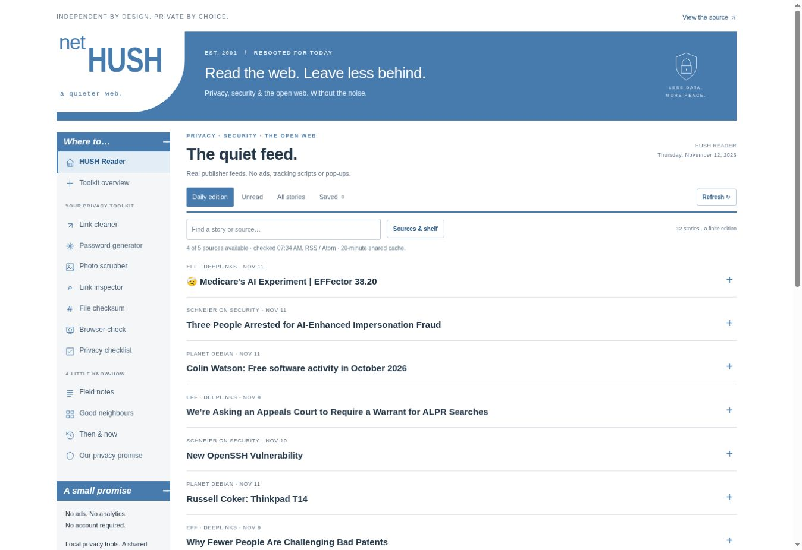

# net HUSH · HUSH Reader

**Read the web. Leave less behind.**

A modern successor to the original 2001 anonymous-surfing site at **nethush.com**. The main application is now a quiet daily reading room. The familiar blue-and-white identity remains, with a smooth white curve around the logo and a continuous blue base aligned above the left menu. Headlines appear directly below the compact masthead; source and shelf settings sit beneath the edition.

[Private hosted preview](https://nethush-reborn.asdfg.chatgpt.site/) · [Deployment](docs/DEPLOYMENT.md) · [Security model](SECURITY.md)



A project by [JSD Technologies](https://jsd.technology).

## The daily reason to visit

Choose sources, open a finite edition of up to 12 recent stories, read plain-text publisher excerpts, and keep the worthwhile ones on your reading shelf. No algorithmic popularity ranking or endless scroll.

- Live RSS / Atom collection through a shared server cache.
- Five initial sources: EFF, Schneier on Security, Planet Debian, selfh.st and Mozilla Hacks.
- Daily edition balanced across selected sources; unread, all-stories and saved views.
- Local search, read/unread marks, save/remove, pagination, and “mark edition read”.
- Optional browser-local persistence, disabled by default. Reading selections and history are never sent to the feed API.
- JSON backup/export and validated merge import, plus OPML export for other readers.
- Clear source health, fetched times, failure handling and stale-cache labels. No fabricated news or silent sample-data fallback.

Feeds refresh automatically on the first visit or manual refresh after the shared 20-minute cache expires. There is no background scheduler and idle tabs do not poll.

The daily edition selects dated items from the last 14 days. Some feeds publish weekly or less frequently, and no story is relabelled as today's news. The edition can change when publishers update their feeds. All stories includes older and undated items. The catalogue is operator-maintained; arbitrary user-entered feed URLs and OPML import are not supported. OPML is export-only.

## Privacy architecture

Every visitor receives the same feed collection. Source filtering, searching, read marks and saved excerpts stay in the browser. The server fetches the entire fixed catalogue, using shared caches, without forwarding visitor cookies, IPs, headers or selections upstream. Cache fills can still occur on visits; this is not a scheduled anonymity network.

Feed HTML is never rendered. Only text excerpts are displayed, with attribution and original-article links. No publisher images, embedded players or scripts load in the reader. Opening an original article connects directly to its publisher. This is not a VPN, general web proxy, paywall bypass, full-article scraper or anonymity guarantee. The net HUSH host can still see visitor requests.

## The toolkit is still here

Link cleaner, link inspector (actual hostname, IDN/credentials/port/tracking flags without visiting), SHA-256 file checksum calculator and comparison (64 MiB cap, no upload), cryptographically random password generator, local photo metadata scrubber, browser footprint check, privacy checklist, guides and history. Tool inputs stay in the browser. No reader accounts, ads, third-party fonts or runtime npm dependencies. Custom aggregate measurements and a protected admin control room use SQLite on Node or D1 in the hosted preview; no visitor identifiers are stored.

## Administration

Open `/admin` for aggregate statistics, feed health and controls, reader copy, cache settings, measurement retention, exports and an admin action log. No raw visitor event log, stored IPs, fingerprints or third-party analytics. Counts are not unique visitors. See [the complete admin and measurement contract](docs/ADMIN.md).

The hosted preview uses owner-only platform sign-in. Self-hosted deployments use a locally configured password (`npm run admin:password`); no default credentials are shipped.

## Run locally

Node.js **24+**, no package installation required. SQLite migrations run at startup; the default database is `var/nethush.sqlite` (ignored by Git):

```sh
npm start
```

Open `http://127.0.0.1:4173`. `PORT` and `HOST` are optional (default loopback binding). The process serves the application and `/api/edition`; restart after source changes. It honours standard proxy environment settings. Serve production through HTTPS using Apache or another reverse proxy. See [deployment instructions](docs/DEPLOYMENT.md).

A static-only copy of `public/` still supports the local tools, but **live reading requires the server endpoint**. The private preview is a Worker build of the same feed service, not a frozen news snapshot.

## Check and build

```sh
npm test
npm run check
npm run build
node scripts/validate-artifact.mjs
```

The dependency-free build embeds the public assets and feed service into `dist/server/index.js`, with an ESM `fetch` handler for Worker hosting. `.openai/hosting.json` retains the existing private preview identity. Generated `dist/` output is ignored in Git.

- `public/`: browser application and assets
- `server/service.js`: fixed-source collector, shared-cache rules and hardened response handler
- `server/local.mjs`: Node adapter for local use / Apache reverse proxy
- `public/assets/catalog.js`: operator-maintained catalogue
- `public/assets/reader-core.js`: feed parsing, plain text, daily selection and backup validation
- `public/admin/`: custom administration UI
- `server/store.js`, `server/admin.js`, `server/application.js`: persistent controls, aggregates and authorization
- `server/auth-node.mjs`: self-hosted admin authentication
- `drizzle/`: SQL migrations, also used by the Node adapter
- `tests/`: Node built-in test runner
- `docs/`: deployment, validation and future direction

GPL-3.0-or-later. Copyright in publisher feed content remains with its respective authors. The original net HUSH identity does not imply endorsement of unrelated deployments.
